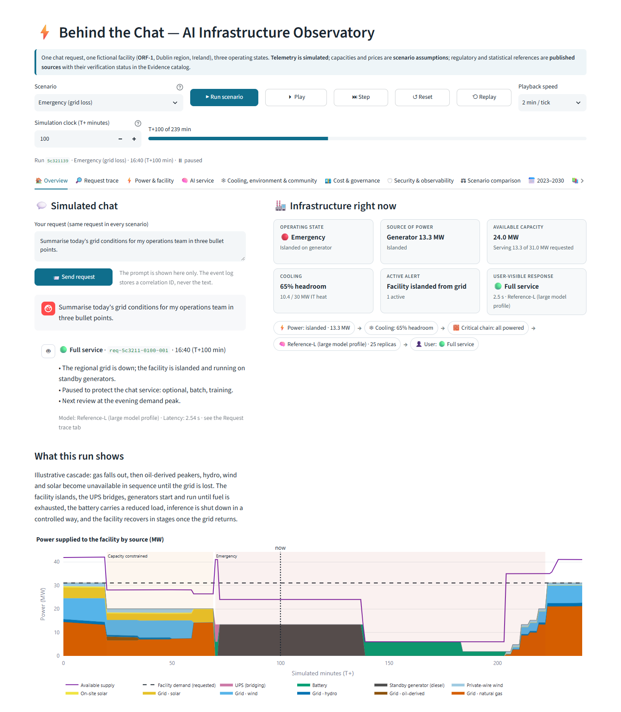
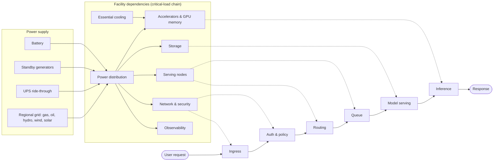
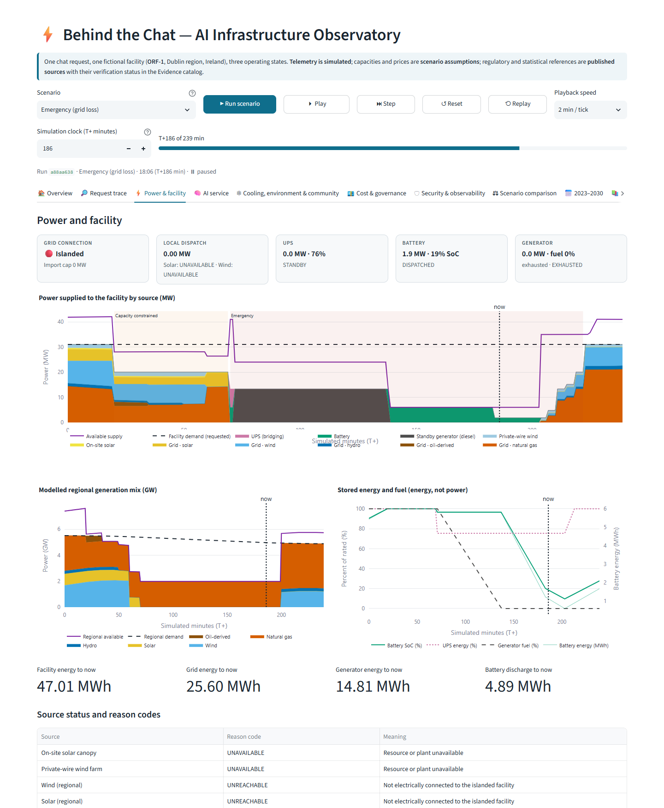
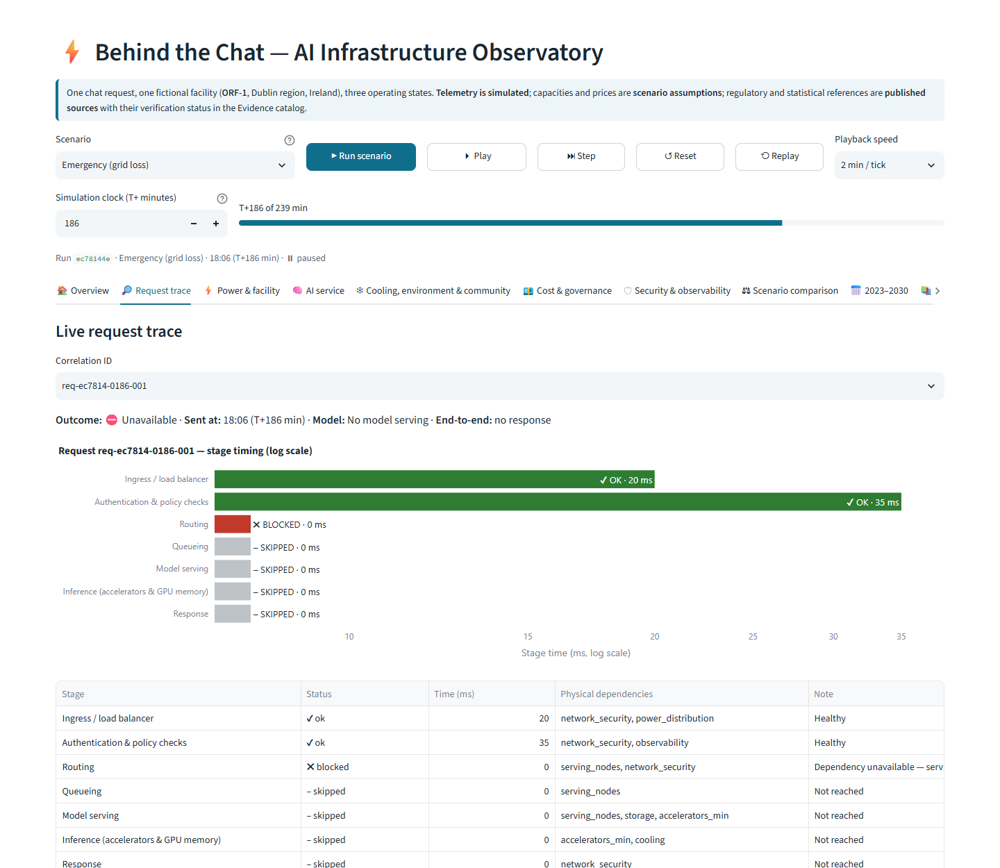
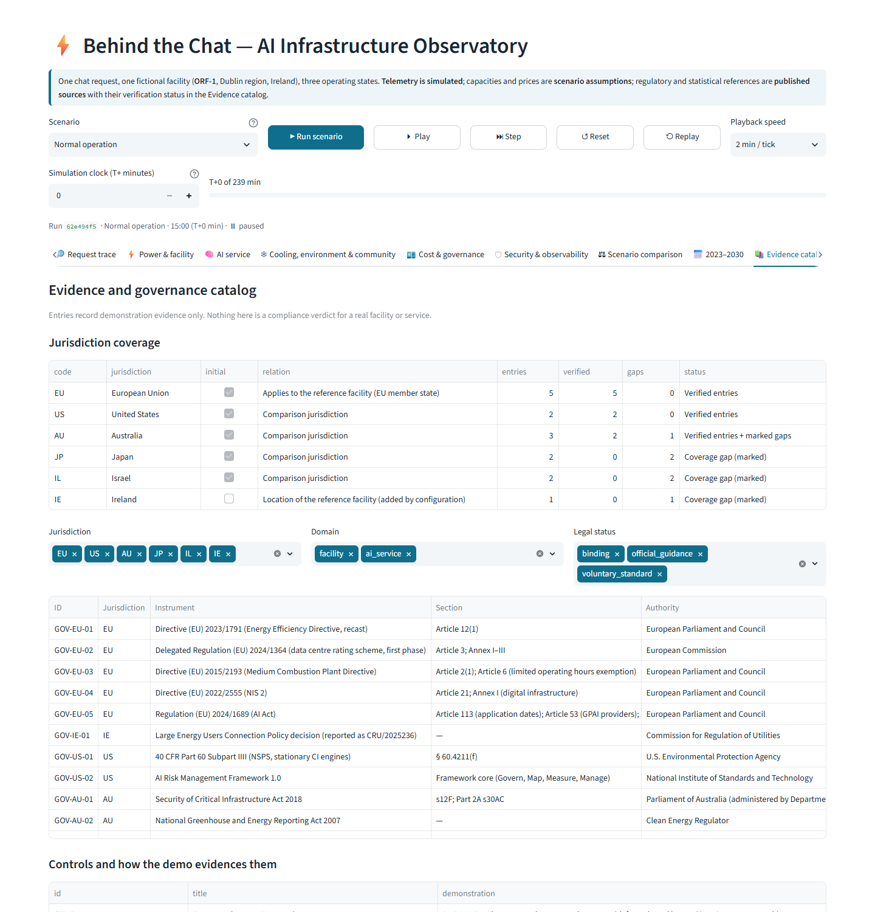

# Behind the Chat — AI Infrastructure Observatory

When you send a message to an AI chat service, the answer depends on more than the model. Somewhere a data center needs power, cooling, network, storage and accelerators, and all of them have to be up at once. This project makes that chain visible.

It is an interactive Streamlit simulation of one **fictional** facility (ORF-1) in a **real** region (Dublin, Ireland). You send the same chat request during **normal operation**, a **capacity shortage** and a **grid outage**, and see what stays online, what slows down, what gets paused, and what each operating decision costs in money, emissions and water.

The full specification is in [PROJECT_BRIEF.md](PROJECT_BRIEF.md).



## Run it

```bash
docker compose up --build
```

Open http://localhost:8501. The container has a health check (`/_stcore/health`). No API keys, paid services or network access are needed at run time: all reference data ships with the repository.

Tests (inside the container or a local Python 3.12 environment with `requirements-dev.txt`):

```bash
docker compose exec observatory python -m pytest -q -p no:cacheprovider
```

Deep links are supported, for example `http://localhost:8501/?scenario=emergency&t=186`.

## How a request depends on the facility



Inference is only served when the whole critical chain is powered. When it isn't, the user gets an explicit "service unavailable" answer instead of a silent failure.

## What you can do in the app

- **Overview**: the simulated chat sits next to the live infrastructure state (operating state, power source, available capacity, cooling, active alert and what the user sees). Play, pause, step, reset or replay the incident.
- **Request trace**: follow one request by correlation ID through every stage and see which physical dependency blocked or slowed it.
- **Power & facility**, **AI service**, **Cooling, environment & community**, **Cost & governance**, **Security & observability**: charts, reason codes, workloads, decision log, control checks, and a filterable event timeline with CSV/JSON export.
- **Scenario comparison**: the same request at the same minute in all three states, plus whole-run totals.
- **2023–2030**: a planning timeline that separates observed, announced and hypothetical milestones.
- **Evidence catalog**: jurisdictions, legal instruments and datasets, each with its verification status. Gaps are marked, not filled in.
- **Help Center**: the three states, key terms, how to read the charts and how to replay a scenario.
- **Explain a number**: any metric can be opened to show its formula, input values, units, sources, date and assumptions.







## What is real and what is not

- **Published**: regulatory texts and statistics, e.g. CSO's figure that data centres used 21% of Irish metered electricity in 2023, or the EU 2024/1364 PUE/WUE formulas. Each one carries a verification status and date.
- **Scenario assumption**: every capacity, price, emission factor and threshold of the fictional facility and its simplified regional grid.
- **Simulated**: every time series, alert, trace and decision. The engine is deterministic, so a replay always produces identical values.

Control checks are demonstration evidence, not a compliance verdict.

## Documentation

- [docs/ARCHITECTURE.md](docs/ARCHITECTURE.md): modules, request path, runtime and data flow
- [docs/SCENARIOS.md](docs/SCENARIOS.md): the three states, dispatch rules, critical-load order, thresholds and recovery
- [docs/DATA-SOURCES.md](docs/DATA-SOURCES.md): provenance, units, formulas, assumptions and limitations
- [docs/GOVERNANCE.md](docs/GOVERNANCE.md): jurisdictions, applicability, controls and evidence gaps

---

**V1.0**: Developed and built by Oren Salami.
