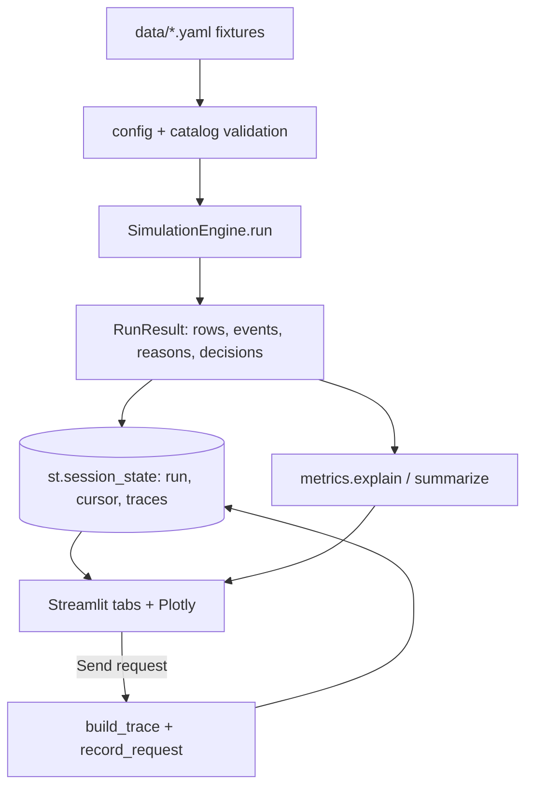

# Architecture

One Dockerized Python application. Streamlit is the entry point; everything that decides or calculates lives in the `observatory` package, which does not import Streamlit and is tested on its own.

## Module boundaries

| Module | Responsibility |
|---|---|
| `observatory/config.py` | Shared scenario schema (pydantic). Loads and validates `data/reference_facility.yaml` and `data/scenarios/*.yaml`. Rejects negative capacities, a reserve above the initial state of charge, events outside the run, unknown event targets, inconsistent thresholds. |
| `observatory/energy.py` | Regional merit-order dispatch (`RegionalGrid`), facility assets (`BatteryState`, `GeneratorState`, `UpsState`), islanding eligibility (`local_source_status`) and reason codes. Power (MW) and energy (MWh) are tracked separately; storage and fuel are floored at zero. |
| `observatory/loads.py` | `LoadManager`: critical-load budget, priority allocation, shedding, inference gating, battery-reserve rule and staged restoration with hysteresis. |
| `observatory/service.py` | `ServiceModel`: replicas from allotted accelerator power, routing to the configured smaller model, deterministic queueing, latency, throughput, GPU utilization and memory, and the user-visible quality (FULL / REDUCED / DEGRADED / UNAVAILABLE). |
| `observatory/events.py` | `EventRecorder`: structured events, alert de-duplication with one recovery event, CSV/JSON export. The schema has no field for prompt text, credentials or user identifiers. |
| `observatory/engine.py` | `SimulationEngine`: composes the modules above. `step()` advances one tick of the deterministic clock; `run()` returns a `RunResult` (per-step rows, events, reason codes, decision log). |
| `observatory/trace.py` | Builds a request trace (correlation ID, seven stages, physical dependencies, outcome, deterministic answer text) from one engine row; logs the request without its content. |
| `observatory/metrics.py` | Metric registry with lineage (formula, inputs, unit, classification, sources, assumptions, boundary) and `explain()` for the metric detail panel. |
| `observatory/catalog.py` | Evidence, governance, timeline and cost catalogs with reference checks and per-jurisdiction coverage. |
| `observatory/observability.py` | Service health and simulated control checks. |
| `observatory/presenter.py` | Pure view-model for the status cards (tested against engine output). |
| `app/streamlit_app.py`, `app/charts.py` | UI and Plotly figures. Read-only consumers of `RunResult`. |

## Request path

`User → Ingress → Authentication & policy → Routing → Queue → Model serving → Inference → Response`

Each stage lists its physical dependencies (`trace.STAGES`). `build_trace` walks the stages for the current engine row. A stage whose dependency is unpowered is **blocked**, and every later stage is **skipped**. Queue time is `queue depth / capacity`, and inference time comes from the service model's latency. Every request gets a correlation ID `req-<run>-<step>-<seq>` and two events (`request_received`, `request_completed`) that carry the ID, outcome and a prompt-size bucket, never the text.

## Runtime and data flow

- **Computed once, replayed by cursor.** Selecting a scenario, pressing **Run scenario** or **Reset** computes a complete deterministic run with a new run ID. Play, pause, step and replay only move a cursor over that result. Streamlit reruns therefore cannot repeat transitions or alerts: they are already in the event list, and alerts were de-duplicated when the run was computed.
- **Session isolation.** Each browser session holds its own run, cursor, traces and request log in `st.session_state`. Comparison runs are shared through `st.cache_resource`; they are immutable and use a fixed run ID.
- **Determinism.** No randomness or wall-clock input reaches the engine. `test_replay_is_repeatable` checks that two runs with different IDs produce identical rows and events.
- **Clean reset.** Reset creates a new run ID and clears the session's request log.

## Deployment

- `Dockerfile`: `python:3.12-slim`, pinned requirements, a non-root user and a `HEALTHCHECK` against `/_stcore/health`.
- `docker-compose.yml`: one service on port 8501, read-only root filesystem with `tmpfs` for `/tmp` and the user home, and the same health check.
- Tests ship in the image: `docker compose exec observatory python -m pytest -q -p no:cacheprovider`.
- Deep links: `?scenario=<normal|constrained|emergency>&t=<minute>` are validated and clamped.

## Design notes

- The clock is a number input with a progress bar instead of `st.slider`. In right-to-left browser locales (for example Hebrew), Streamlit's slider draws its thumb mirrored, so the position would misreport the clock.
- Colors follow an Okabe–Ito-based palette and are always paired with text or icons (state badges, ✔/⏱/✖ trace markers, labelled state bands on charts).
